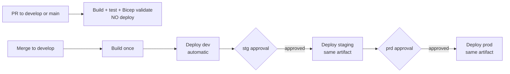

# 1 — Environment & Promotion Model

Back to the guide index: [README.md](./README.md)

## Three environments

VDAB deploys to three independent Azure environments. Each has its **own** App Service, Key Vault, and
Databricks Lakebase Postgres branch. All live in the single shared resource group `vdab`.

| Environment | App Service | Public URL | Lakebase branch | Purpose |
|-------------|-------------|------------|-----------------|---------|
| **Local** | — | `http://localhost:5173` | local PostgreSQL | Developer machines (Aspire AppHost). |
| **dev** | `xorbix-vdab-dev` | `https://xorbix-vdab-dev.azurewebsites.net` | `dev` | Integration target for merged work. |
| **stg** | `xorbix-vdab-stg` | `https://xorbix-vdab-stg.azurewebsites.net` | `stg` | Pre-production validation / sign-off. |
| **prd** | `xorbix-vdab-prd` | `https://app.vdab.ai` | `prd` | Live production. |

## CI/CD flow — build once, promote the same artifact

The pipeline builds **one** environment-agnostic artifact per commit to `develop` and promotes that exact
artifact through the environments. Nothing is rebuilt per environment, so what you sign off in staging is
byte-for-byte what reaches production.

### What runs when

| Trigger | Build + test + Bicep validate | dev | staging | prod |
|---------|-------------------------------|-----|---------|------|
| **PR** into `develop` or `main` | ✅ | ❌ | ❌ | ❌ |
| **Merge/commit** to `develop` | ✅ (once) | ✅ automatic | ⏸ awaits **stg** approval | ⏸ awaits **prd** approval |

Each merge to `develop` produces one run = one **release candidate**: it deploys dev immediately, then holds
at the staging and prod approval gates. You approve only the candidate you intend to ship (superseded
candidates can be abandoned). There is no environment picker — the single pipeline
([`.pipelines/azure-pipelines.yml`](../../.pipelines/azure-pipelines.yml)) runs the whole dev → staging → prod
chain, gated by Azure DevOps Environment checks.

## Recommended branch & promotion workflow

Gates are enforced by Azure DevOps Environments, not the YAML alone (see
[3 — Service connections & access](./3-service-connections-and-access.md)).

1. **Feature work** → PR into `develop`. The pipeline builds, tests, and validates Bicep but does **not** deploy.
2. **Merge to `develop`** → the pipeline builds one artifact and **auto-deploys dev**, then pauses at the
   staging gate.
3. **Approve staging** → the same artifact deploys to staging; validate / sign off.
4. **Approve production** → the same artifact deploys to prod (higher-bar approval).
5. **Record the release on `main`** → merge `develop` → `main` (PR-reviewed) so `main` reflects exactly what
   is in production. `main` is the **production record + hotfix base**; it does not trigger builds.

### A note on `main` and the production gate

Because one artifact is promoted within a single run that originates from `develop`, the prod deploy is gated
by **approval** (the higher bar), not by a hard "branch must be `main`" check on the run — such a check would
block every `develop`-sourced candidate. `main`'s role is the auditable production record and the branch you
cut hotfixes from; protect it with a PR policy (required reviewers) and update it as part of releasing.

> Want a hard "prod only from `main`" gate while still building once? That needs cross-run artifact promotion
> (a separate prod run on `main` that re-uses the develop build's artifact instead of rebuilding). It's more
> moving parts — ask and we'll wire it up.

## Environment configuration is resolved at runtime (this is what enables build-once)

The build bakes in **nothing** environment-specific. The SPA resolves everything per environment at runtime:

- **API base URL** → same-origin (relative); the SPA is co-hosted with the API and calls its own origin.
- **Databricks OAuth redirect** → `window.location.origin + "/callback"`, computed in the browser.
- **Application Insights** → fetched from the API endpoint `GET /api/config` at startup.

Custom domains (`app.vdab.ai`) are bound to the same App Service and permitted via CORS
(`ApplicationConfiguration:AllowedOrigins`, set per environment in the `.bicepparam` files). Because the API
and SPA share an origin, calls work whether the user opens the `*.azurewebsites.net` host or the custom domain.

## Backend public URL (email links)

`ApplicationConfiguration:FrontendUrl` is the canonical URL used for outbound email/reset links. It is set per
environment by the `frontendUrl` Bicep parameter:

| Environment | `frontendUrl` |
|-------------|---------------|
| dev | empty → defaults to `https://xorbix-vdab-dev.azurewebsites.net` |
| stg | `https://xorbix-vdab-stg.azurewebsites.net` |
| prd | `https://app.vdab.ai` |

## Databricks OAuth callbacks

Register every UI origin that will sign in to Databricks (with the `/callback` path) in the Databricks App
Connection — see [databricks-oauth-admin-setup-guide.md](../databricks-oauth-admin-setup-guide.md):

| URL |
|-----|
| `https://xorbix-vdab-dev.azurewebsites.net/callback` |
| `https://xorbix-vdab-stg.azurewebsites.net/callback` |
| `https://app.vdab.ai/callback` |
| `https://app.vdab.io/callback` |
| `https://xorbix-vdab-prd.azurewebsites.net/callback` |
| `http://localhost:5173/callback` (local) |

> **Today:** `app.vdab.ai` and `app.vdab.io` are still bound to **`xorbix-vdab-dev`** (the dev App Service is the
> de-facto production host). They move to `xorbix-vdab-prd` at go-live — see
> [8 — Production go-live & domain cutover](./8-production-go-live.md).
