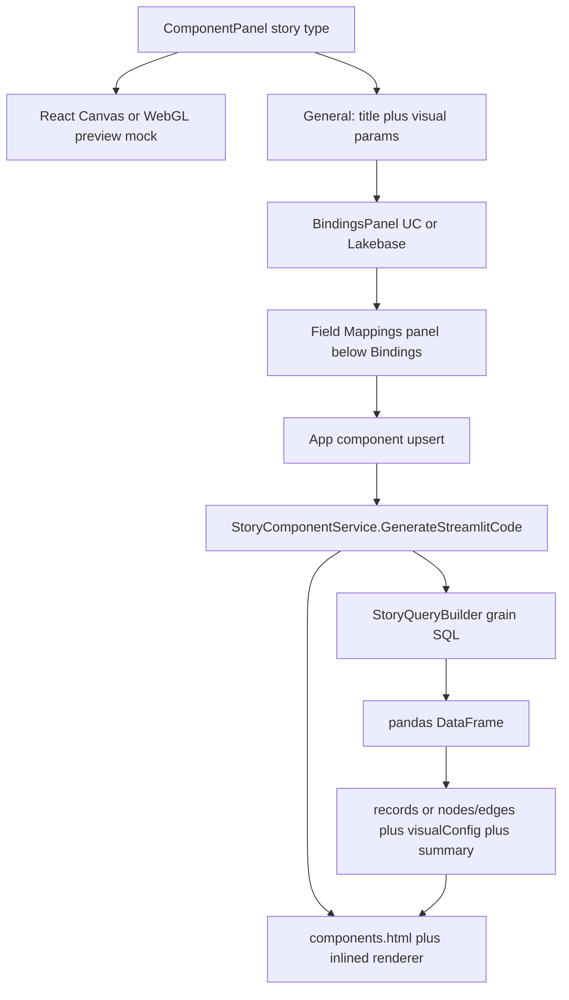
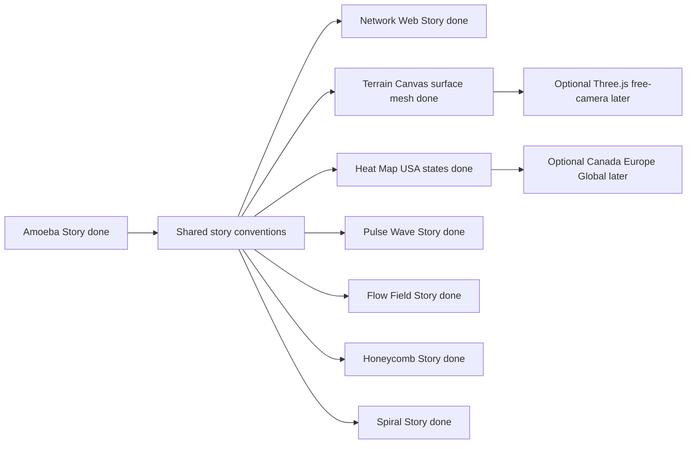

# VDAB Story Visualizations

**Last Updated:** 2026-08-05  
**Source requirements:** VDAB POC Visualization Requirements (Amoeba Story, Terrain Story, Network Web Story, Heat Map Story, Pulse Wave Story, Flow Field Story, Honeycomb Story, Spiral Story)
**Status:** Amoeba Story, Network Web Story, Terrain Story, Heat Map Story, Pulse Wave Story, Flow Field Story, Honeycomb Story, and Spiral Story implemented (POC).

This document captures the product requirements for all eight story visualizations and the implementation pattern established by Amoeba Story, which the other stories follow.

---

## Overview

Story visualizations are first-class **Visualization** components in VDAB. They sit beside classic Plotly charts (Bar, Line, Pie, Donut) but use:

- **Semantic field-role mapping** (not just X/Y axes)
- **SQL / Lakebase grain transforms** into a standard renderer payload
- **Vanilla Canvas / WebGL HTML** embedded via Streamlit `components.html` (no new npm/NuGet deps for story POCs)

| Story | Metaphor | Best for | Runtime tech (requirements) | VDAB status |
| --- | --- | --- | --- | --- |
| **Amoeba Story** | Living organic blobs | Portfolio size, growth, health, risk, position | D3 / SVG / Canvas → **vanilla Canvas** in VDAB | Implemented |
| **Terrain Story** | Performance landscape | Regional / product performance topography | Three.js / WebGL / Plotly 3D → **vanilla Canvas isometric `surface` mesh** (+ heat / ridge) in VDAB | Implemented |
| **Network Web Story** | Relationship graph | Supply chain, dependencies, influence | D3 force / Cytoscape → **vanilla Canvas** in VDAB | Implemented |
| **Heat Map Story** | Geographic intensity choropleth | Sales / risk / demand by state or region | Leaflet / D3 geo → **vanilla Canvas + embedded USA state boundaries** in VDAB | Implemented (USA states MVP) |
| **Pulse Wave Story** | Performance rhythm waveform | Trends, volatility, event-aligned spikes/drops | D3 / Canvas → **vanilla Canvas** wave in VDAB | Implemented |
| **Flow Field Story** | Directional stage streams | Funnels, journeys, process conversion / leakage | D3 Sankey / Canvas → **vanilla Canvas** streams in VDAB | Implemented |
| **Honeycomb Story** | Hexagonal impact map | Strategic initiatives, scorecards, portfolio priority | D3 / Canvas → **vanilla Canvas** hex clusters in VDAB | Implemented |
| **Spiral Story** | Progressive journey spiral | Milestone journeys, staged programs, schedule risk | D3 / Canvas → **vanilla Canvas** Archimedean spiral in VDAB | Implemented |

Classic charts stay on `st.plotly_chart`. Story visuals use `streamlit.components.v1 as components` + self-contained HTML/JS.

---

## Shared architecture (follow Amoeba)



### Vertical slice checklist (every new story)

Work bottom-up; confirm each layer before moving on.

| Layer | Work |
| --- | --- |
| **Enums** | `ComponentType` in C# + mirror in `componentTypes.ts` |
| **DTO** | `*StoryComponentDto` + props (role fields as `ChartAxisConfigDto`, visual params) |
| **Converter** | `VdabComponentDtoConverter` + `StreamlitGenerationService.IsComponentRuntimeTypeValid` |
| **Service** | `I*StoryComponentService` + `*StoryComponentService` under `Services/ComponentRegistry/Components/Stories/` |
| **SQL helper** | `*QueryBuilder` using `ChartQueryHelper` + `ChartSqlDialectHelper` |
| **HTML helper** | `*StreamlitHtmlHelper` with `__PAYLOAD__` placeholder + inlined JS |
| **DI** | Register in `AddComponentRegistry` |
| **Template** | `StreamlitTemplateService` feature flag → import `components` (+ `json` if needed) |
| **Frontend editor** | General visual props in `*PropertyEditor`; **Field Mappings** panel below Bindings |
| **Columns** | Use `resolveBindingColumns()` (`source.resource.columns` for UC / Lakebase / autoscaling) |
| **Canvas** | Renderer in `src/components/renderers/stories/` + `ComponentRendererFactory` |
| **Palette** | Icon in `componentPaletteIcons.tsx` |
| **AI maps** | Category / bindings / DTO factory in `CanvasToolPlugin`; dedicated `add*Story` tools for all eight stories (Amoeba, Network Web, Terrain, Heat Map, Pulse Wave, Flow Field, Honeycomb, Spiral) with optional `fieldMappingsJson`, then static UC/Lakebase bind. Unmapped required roles → `PARTIAL` directing the user to Properties → Field Mappings. |
| **Tests** | Component service generation tests (bind / unbound / Lakebase vs UC); AI Builder field-mapping helper tests in `Tests/AiBuilder/StoryAiFieldMappingHelperTests.cs` |

### Payload contract pattern

Every story emits JSON with three sections:

1. **Data** — `records[]` or `nodes[]` + `edges[]`
2. **visualConfig** — layout / color / animation params from props
3. **summary** — counts, exclusions, warnings

Builder canvas uses **mock data** (like Plotly charts). Live data appears after Streamlit generate/deploy.

### Bindings

All eight stories support the same binding sources as charts:

- `unityCatalogTable`
- `lakebaseProvisionedDatabase`
- `lakebaseAutoscaling`

Field mappers must read columns from `bindings.<type>.source.resource.columns` via `resolveBindingColumns`.

### Properties panel layout (Amoeba pattern)

1. **General** — Code name, title, visual settings  
2. **Bindings** — Table binding  
3. **Field Mappings** — Role → column pickers (required + optional)  
4. **Workflows**

Do not bury field mappings above Bindings; columns are empty until a table is bound.

### Deferred across all stories (v1 POC)

- AI `Add*Story` canvas tools (DTO maps may still register the type)
- Workflow `SetBinding` / `storyData` override
- Interactive time scrubber (Amoeba: latest period only when `time_field` mapped)
- Full physics / force layout polish
- New third-party packages without Dependency Approval

### Recommended libraries (from requirements PDF)

| Story | Fully possible in Streamlit + HTML/JS? | Suggested tech |
| --- | --- | --- |
| Amoeba | Yes | D3, SVG, Canvas → VDAB uses **vanilla Canvas** |
| Terrain | Yes | Three.js / WebGL / Plotly 3D → VDAB v1 uses **vanilla Canvas** isometric `surface` mesh (bilinear upsample), plus `heat_surface` / `ridge` |
| Network Web | Yes | D3 force / Cytoscape → VDAB uses **vanilla Canvas** |
| Heat Map | Yes | Leaflet / D3 geo → VDAB v1 uses **vanilla Canvas** + embedded USA state lon/lat rings (no map library) |
| Pulse Wave | Yes | D3 / Canvas → VDAB uses **vanilla Canvas** waveform |
| Flow Field | Yes | D3 Sankey / Canvas → VDAB uses **vanilla Canvas** stage streams |
| Honeycomb | Yes | D3 / Canvas → VDAB uses **vanilla Canvas** hex clusters |
| Spiral | Yes | D3 / Canvas → VDAB uses **vanilla Canvas** Archimedean spiral |

Prefer matching Amoeba’s **no new dependency** approach when feasible; otherwise run the Dependency Approval evaluation before adding packages.

---

## 1. Amoeba Story — Dynamic Cluster Story

### Product description

Organic scatter/cluster visualization where every entity becomes a living amoeba shape containing key performance details.

- **Primary goal:** Show relative size, growth, category, health, risk, and position without plain dots.
- **Best use cases:** Customer portfolio, product portfolio, vendor value/risk, application rationalization, project portfolio, department performance.
- **User value:** Immediately see which entities are large, growing, shrinking, risky, healthy, or out of position.

### Required data points

| Data point | Type | Purpose | Visual encoding | Examples |
| --- | --- | --- | --- | --- |
| `entity_id` | String or numeric key | Stable unique ID | Selection, update, detail lookup | `customer_id`, `product_id`, `vendor_id` |
| `entity_label` | String | Display name | Label inside or near amoeba | `customer_name`, `product_name` |
| `category` | String | Groups related entities | Cluster, legend, color family | `segment`, `region`, `department` |
| `time_field` | Date / timestamp / period | Timeframe filter and trend logic | Filters source data | `month`, `quarter`, `snapshot_date` |
| `size_metric` | Numeric | Main value compared | Amoeba radius / area | `revenue`, `arr`, `spend`, `cost` |
| `x_metric` | Numeric | Horizontal comparison | X position (scatter / hybrid) | `growth_pct`, `margin_pct`, `value_score` |
| `y_metric` | Numeric | Vertical comparison | Y position (scatter / hybrid) | `risk_score`, `health_score`, `profitability` |
| `change_metric` | Numeric delta or % | Growth / decline / movement | Secondary label, trend | `change_pct`, `revenue_delta` |

> **VDAB v1 note:** `time_field` is optional in the Field Mappings UI. When mapped, SQL keeps the latest period only (`time_field = MAX(time_field)`). Required roles for render: entity id/label, category, size, x, y, change.

### Optional data points

| Data point | Type | Enhancement |
| --- | --- | --- |
| `health_score` | 0–100 numeric | Color / brightness and health classification |
| `risk_score` | 0–100 numeric | Pulsing border, warning halo, unstable membrane |
| `contribution_pct` | Numeric % | Internal contribution label |
| `comparative_value` | Numeric or string | Prior / benchmark / target / rank |
| `target_value` | Numeric | Target outline or variance |
| `status` | String enum | On Track, Watch, At Risk, Critical |
| `owner` | String | Tooltip / detail / filter |
| `event_name` / `event_date` | String + date | Event markers |
| `detail_metric_1..5` | Label/value pairs | Extra tooltip metrics |

> **VDAB v1:** Implements `health_score` and `risk_score`. Other optionals deferred.

### Visualization parameters

| Parameter | Allowed values | Default | Behavior |
| --- | --- | --- | --- |
| `layout_mode` | `scatter` \| `cluster` \| `hybrid` | `hybrid` | Scatter uses x/y; cluster by category; hybrid blends both |
| `size_scale` | `linear` \| `sqrt` \| `log` | `sqrt` | Maps size_metric → radius |
| `min_radius_px` / `max_radius_px` | Integer | `42` / `130` | Radius clamp |
| `color_by` | Mapped field | `health_score` or `category` | Interior color (`category` \| `health_score` in VDAB) |
| `pulse_by` | Mapped field \| `none` | `risk_score` | Border pulse intensity |
| `shape_variation` | 0.0–1.0 | `0.35` | Organic border distortion |
| `label_mode` | `none` \| `compact` \| `full` | `compact` | Visible text amount |
| `animation_enabled` | Boolean | `true` | Pulse and organic motion |

### Data transformation rules

| Rule | Requirement |
| --- | --- |
| Filter | Apply time filter when `time_field` is mapped |
| Grain | Aggregate to one row per `entity_id` for the selected timeframe |
| Aggregation | User chooses sum, average, max, min, latest, or weighted average for numeric fields |
| Derived change | If `change_metric` not mapped but prior period exists, derive `(current - prior) / prior` |
| Normalization | Normalize size, x, y, risk, health for renderer space |
| Layout | Collision avoidance so blobs and labels do not overlap |

> **VDAB v1:** Supports existing chart transforms (`none`, `sum`, `avg`, `min`, `max`, `count`, `count_distinct`). Skips `latest` / weighted average / derived prior-period change. Collision is a simple iterative nudge + edge clamp. `LIMIT 100`.

### Interactions and acceptance

| Interaction | Requirement |
| --- | --- |
| Hover | Tooltip with label, category, size, x/y, change, health/risk, optionals |
| Click | Select amoeba (selection ring) |
| Legend filter | Filter by category |
| Layout toggle | Switch scatter / cluster / hybrid when fields available |
| Pan / zoom | Drag to pan, scroll to zoom, double-click reset (deployed HTML) |
| Acceptance | Render ≥25 amoebas with unique size, position, label, color, hover, selected state |

### Minimum renderer payload

```json
{
  "records": [
    {
      "entity_id": "...",
      "entity_label": "...",
      "category": "...",
      "size_value": 0,
      "x_value": 0,
      "y_value": 0,
      "change_value": 0,
      "health_score": 0,
      "risk_score": 0
    }
  ],
  "visualConfig": {
    "layout_mode": "hybrid",
    "size_scale": "sqrt",
    "min_radius_px": 42,
    "max_radius_px": 130,
    "color_by": "category",
    "pulse_by": "risk_score",
    "shape_variation": 0.35,
    "label_mode": "compact",
    "animation_enabled": true
  },
  "summary": {
    "total_entities": 0,
    "excluded_rows": 0,
    "warnings": []
  }
}
```

### How to read the viz (analysis)

| Visual cue | Meaning |
| --- | --- |
| Blob size | Magnitude of size metric (e.g. revenue) |
| Position | X/Y metrics (e.g. growth vs risk) |
| Color | Category or health |
| Pulse / red border | Elevated risk |
| Label % | Change metric (full label mode) |
| Overlap | Layout density — **not** a business relationship |
| Animation wobble | Visual style / risk pulse — **not** time-series motion |

### VDAB implementation map (Amoeba — done)

| Concern | Location |
| --- | --- |
| Enum | `ComponentType.AmoebaStory` (C# + TS) |
| DTO | `Models/DTOs/BuilderComponents/AmoebaStoryComponentDto.cs` |
| Service | `Services/ComponentRegistry/Components/Stories/AmoebaStoryComponentService.cs` |
| SQL | `Stories/Helpers/AmoebaQueryBuilder.cs` |
| HTML/JS | `Stories/Helpers/AmoebaStreamlitHtmlHelper.cs` |
| DI | `ComponentRegistry/ServiceCollectionExtensions.cs` |
| Feature flag | `StreamlitTemplateService` → `HasCustomHtmlStoryComponents` |
| General editor | `client/.../properties/AmoebaStoryPropertyEditor.tsx` |
| Field mappings | `client/.../properties/AmoebaStoryFieldMappingsPanel.tsx` (below Bindings) |
| Columns helper | `client/.../utils/bindings/resolveBindingColumns.ts` |
| Canvas preview | `client/.../renderers/stories/AmoebaStoryRenderer.tsx`, `amoebaCanvasDraw.ts`, `generateAmoebaPreviewData.ts` |
| Sample data | `.documentation/samples/amoeba_story.csv` |
| Tests | `Tests/ComponentRegistry/AmoebaStoryComponentServiceTests.cs` |

### Demo field mapping (sample CSV)

| Role | Column | Transform |
| --- | --- | --- |
| Entity ID | `customer_id` | none |
| Entity label | `customer_name` | none |
| Category | `segment` | none |
| Size | `revenue` | sum |
| X | `growth_pct` | avg |
| Y | `risk_score` | avg |
| Change | `change_pct` | avg |
| Time (optional) | `snapshot_date` | none |
| Health / Risk (optional) | `health_score` / `risk_score` | avg |

---

## 2. Terrain Story — Topography of Performance

### Product description

3D or 2.5D performance landscape where mountains, valleys, slopes, and callouts represent business performance.

- **Primary goal:** Geography as metaphor — peaks are strong areas, valleys are weak, cliffs are sudden changes.
- **Best use cases:** Regional performance, manufacturing output, quality analysis, margin/cost landscapes, capacity planning, product performance over time.
- **User value:** See where performance is high, where it dipped, and what deserves investigation.

### Required data points

| Data point | Type | Purpose | Visual encoding | Examples |
| --- | --- | --- | --- | --- |
| `x_dimension` | Date, numeric, or category | First ground-plane dimension | X coordinate or bucket | `month`, `week`, `region`, `plant` |
| `y_dimension` | Category or numeric | Second ground-plane dimension | Y coordinate, band, or bin | `line`, `product`, `segment`, `defect_type` |
| `height_metric` | Numeric | Elevation | Mountain height / valley depth | `revenue`, `output_units`, `margin`, `defect_rate` |
| `time_field` | Date / timestamp / period | Timeframe filter / playback | Filters source data | `production_date`, `snapshot_month` |
| `aggregation_method` | Enum setting | How rows become grid values | Pre-render aggregation | `sum`, `avg`, `max`, `min`, `latest` |

### Optional data points

| Data point | Type | Enhancement |
| --- | --- | --- |
| `terrain_category` | String | Layers, color regions, filtering |
| `risk_score` | 0–100 numeric | Danger zones, storm/fog, hazard pins |
| `target_value` | Numeric | Reference plane / benchmark elevation |
| `baseline_value` | Numeric | Variance from normal / prior |
| `forecast_value` | Numeric | Ghost surface / future extension |
| `event_name` / `event_date` | String + date | Pins / callouts |
| `status` | String enum | Normal, warning, critical, blocked, failed |
| `volume_metric` | Numeric | Density, opacity, marker size |
| `callout_text` | String | Text on important points |
| `geo_lat` / `geo_lon` | Numeric | Optional geographic terrain mode |

### Visualization parameters

| Parameter | Allowed values | Default | Behavior |
| --- | --- | --- | --- |
| `terrain_mode` | `surface` \| `ridge` \| `heat_surface` \| `geo_surface` | `surface` | Rendering mode |
| `x_bucket_size` | `day` \| `week` \| `month` \| `quarter` \| `category` \| `numeric_bin` | `month` | X grouping |
| `y_bucket_mode` | `category` \| `numeric_bin` \| `geo` | `category` | Y grouping |
| `height_scale` | Number | `1.0` | Elevation amplify / reduce |
| `interpolation` | `none` \| `linear` \| `bilinear` \| `idw` | `bilinear` | Smoothing between points |
| `grid_resolution` | Integer | `60` | Mesh density |
| `color_by` | `height_metric` \| `risk_score` \| `variance` \| `category` | `height_metric` | Surface color / overlay |
| `show_peak_labels` / `show_valley_labels` | Boolean | `true` / `true` | Label highs / lows |
| `camera_preset` | `front` \| `angled` \| `top` \| `free` | `angled` | Initial camera |

### Data transformation rules

| Rule | Requirement |
| --- | --- |
| Filter | Apply time filter before aggregation |
| Grid | Group by x bucket × y bucket; aggregate `height_metric` |
| Missing cells | Zero fill, null gap, or interpolation (warn if interpolating) |
| Peak / valley | Top peaks, lowest valleys, sharp drops after aggregation |
| Slope / cliff | Neighbor cell deltas for cliffs and dips |
| Variance | When target/baseline mapped, compute variance for overlays |

### Interactions and acceptance

| Interaction | Requirement |
| --- | --- |
| Rotate / pan / zoom | Inspect terrain interactively |
| Hover | x, y, height, risk, target, variance, events |
| Click | Select cell / peak / valley / event → detail panel |
| Toggle overlays | Peaks, valleys, events, risk, target plane |
| View switch | 3D perspective ↔ top-down heat / contour |
| Acceptance | Terrain from mapped x/y/height; label top 3 peaks and bottom 3 valleys |

### Minimum renderer payload

```json
{
  "records": [
    { "x": "...", "y": "...", "height": 0, "risk_score": 0, "target_value": 0, "baseline_value": 0, "forecast_value": 0, "category": "..." }
  ],
  "callouts": [
    { "x": "...", "y": "...", "label": "...", "metric_value": 0, "severity": "...", "event_date": null, "description": "..." }
  ],
  "visualConfig": {
    "terrain_mode": "surface",
    "x_bucket_size": "month",
    "y_bucket_mode": "category",
    "height_scale": 1.0,
    "interpolation": "bilinear",
    "grid_resolution": 60,
    "color_by": "height_metric",
    "camera_preset": "angled"
  },
  "summary": {
    "grid_size": 0,
    "excluded_rows": 0,
    "top_peaks": [],
    "bottom_valleys": [],
    "warnings": []
  }
}
```

### VDAB implementation map (Terrain — done)

| Concern | Location / notes |
| --- | --- |
| Enum | `ComponentType.TerrainStory` (C# + TS) |
| DTO | `Models/DTOs/BuilderComponents/TerrainStoryComponentDto.cs` |
| Service | `Services/ComponentRegistry/Components/Stories/TerrainStoryComponentService.cs` |
| SQL | `Stories/Helpers/TerrainQueryBuilder.cs` — GROUP BY x,y; aggregate height; latest period if time mapped; `LIMIT 500` |
| Transform | Python builds records, variance, top 3 peaks / bottom 3 valleys, event callouts |
| HTML/JS | `Stories/Helpers/TerrainStreamlitHtmlHelper.cs` — Canvas `surface` (isometric height-field + bilinear upsample), `heat_surface`, `ridge`; pan/zoom; peak/valley/event toggles. Algorithm mirrored in client `terrainCanvasDraw.ts`. |
| Feature flag | `StreamlitTemplateService` → `HasCustomHtmlStoryComponents` |
| General editor | `client/.../properties/TerrainStoryPropertyEditor.tsx` |
| Field mappings | `client/.../properties/TerrainStoryFieldMappingsPanel.tsx` (below Bindings) |
| Canvas preview | `client/.../renderers/stories/TerrainStoryRenderer.tsx`, `terrainCanvasDraw.ts`, `generateTerrainPreviewData.ts` |
| Sample data | `.documentation/samples/terrain_story.csv` |
| Tests | `Tests/ComponentRegistry/TerrainStoryComponentServiceTests.cs` |

### Demo field mapping (sample CSV)

Sample: [`.documentation/samples/terrain_story.csv`](samples/terrain_story.csv) — manufacturing plants × product families × months (144 rows; latest month ≈ 48 cells).

| Field Mapping role | Column | Transform |
| --- | --- | --- |
| X dimension | `report_month` | none |
| Y dimension | `product_family` | none |
| Height metric | `output_units` | sum |
| Time field (optional) | `report_month` | none → latest period |
| Terrain category (optional) | `region` | none |
| Risk score (optional) | `quality_risk_score` | avg |
| Target value (optional) | `target_output_units` | avg |
| Baseline value (optional) | `prior_period_output_units` | avg |
| Forecast value (optional) | `forecast_output_units` | avg |
| Volume metric (optional) | `scrap_units` | sum |
| Status (optional) | `line_status` | none |
| Event name (optional) | `incident_name` | none |
| Event date (optional) | `incident_date` | none |
| Callout text (optional) | `notes` | none |

Alternate layout: X = `plant_name`, Y = `product_family`, Time = `report_month`.

---

## 3. Network Web Story — Relationship Web

### Product description

Interactive network graph where nodes are entities and edges are relationships, transactions, dependencies, or influence.

- **Primary goal:** Reveal connected entities, clusters, influence, dependencies, high-risk paths, and isolates.
- **Best use cases:** Supply chain, vendor networks, customer influence, fraud patterns, application dependencies, data lineage, partner ecosystems.
- **User value:** See not just individual values, but how entities affect each other.

### Required data points

| Data point | Type | Purpose | Visual encoding | Examples |
| --- | --- | --- | --- | --- |
| `source_entity_id` | String or numeric key | Source node ID | Source node create / match | `supplier_id`, `source_system_id` |
| `source_entity_label` | String | Source display | Source label / tooltip | `supplier_name`, `source_table` |
| `target_entity_id` | String or numeric key | Target node ID | Target node create / match | `plant_id`, `target_system_id` |
| `target_entity_label` | String | Target display | Target label / tooltip | `plant_name`, `downstream_dashboard` |
| `relationship_type` | String | Connection class | Edge style, color, legend, filter | `supplies`, `owns`, `depends_on` |
| `relationship_weight` | Numeric | Strength | Edge width, force/link strength | `spend`, `frequency`, `dependency_score` |

### Optional data points

| Data point | Type | Enhancement |
| --- | --- | --- |
| `time_field` | Date / timestamp / period | Filter by time / recency |
| `direction` | Enum | Arrowheads or animated flow |
| `edge_value` | Numeric | Transaction / spend / volume |
| `frequency` | Numeric | Interaction count |
| `edge_risk_score` | 0–100 numeric | Warning edge color / pulse |
| `edge_status` | String enum | Active, inactive, blocked, failed, suspicious |
| `node_category` | String | Node group / community / legend |
| `node_value` | Numeric | Node size |
| `node_health_score` | 0–100 numeric | Node brightness / health color |
| `node_risk_score` | 0–100 numeric | Node warning halo |
| `owner` | String | Filter / detail |
| `description` | String | Tooltip context (**must be escaped**) |

### Visualization parameters

| Parameter | Allowed values | Default | Behavior |
| --- | --- | --- | --- |
| `layout_algorithm` | `force` \| `radial` \| `hierarchical` \| `concentric` | `force` | Node placement |
| `node_size_by` | `node_value` \| `degree` \| `centrality` \| `fixed` | `degree` | Node radius |
| `node_color_by` | `node_category` \| `node_risk_score` \| `node_health_score` \| `community` | `node_category` | Node color |
| `edge_width_by` | `relationship_weight` \| `edge_value` \| `frequency` \| `fixed` | `relationship_weight` | Edge thickness |
| `edge_color_by` | `relationship_type` \| `edge_risk_score` \| `edge_status` | `relationship_type` | Edge style / color |
| `show_arrows` | Boolean | `true` if direction mapped | Direction |
| `highlight_depth` | `1` \| `2` \| `3` | `1` | Hops highlighted on select |
| `min_weight_filter` | Numeric | `0` | Drop weak edges |
| `community_detection` | `none` \| `category` \| `modularity` | `category` | Clusters |
| `max_nodes` / `max_edges` | Integer | `300` / `800` | Payload caps before requiring filters |

### Data transformation rules

| Rule | Requirement |
| --- | --- |
| Edge list | Transform rows into unique source–target relationship edges |
| Duplicate edges | Aggregate duplicate source–target–type rows |
| Node extraction | Derive nodes from source/target when no node table exists |
| Node attributes | Merge optional node attributes by ID |
| Time filter | Filter relationships when `time_field` mapped |
| Graph metrics | Degree, weighted degree, community before render |
| Pruning | `min_weight`, `max_nodes`, `max_edges`, top-N, depth filters |

### Interactions and acceptance

| Interaction | Requirement |
| --- | --- |
| Zoom / pan | Navigate the network |
| Hover node | Label, category, value, degree, weighted degree, risk, health, owner |
| Hover edge | Source, target, type, weight, value, frequency, direction, status |
| Click node | Highlight 1–3 hop neighborhood; detail panel |
| Search | Find and focus node by label |
| Filter | Relationship type, node category, status, min weight |
| Acceptance | ≥50 nodes and ≥100 edges with hover, click-to-focus, search, visible relationship strength |

### Minimum renderer payload

```json
{
  "nodes": [
    {
      "id": "...",
      "label": "...",
      "category": "...",
      "value": 0,
      "health_score": 0,
      "risk_score": 0,
      "owner": "...",
      "degree": 0
    }
  ],
  "edges": [
    {
      "source": "...",
      "target": "...",
      "relationship_type": "...",
      "relationship_weight": 0,
      "direction": "...",
      "edge_value": 0,
      "frequency": 0,
      "status": "...",
      "risk_score": 0
    }
  ],
  "visualConfig": {
    "layout_algorithm": "force",
    "node_size_by": "degree",
    "node_color_by": "node_category",
    "edge_width_by": "relationship_weight",
    "edge_color_by": "relationship_type",
    "highlight_depth": 1,
    "min_weight_filter": 0
  },
  "summary": {
    "node_count": 0,
    "edge_count": 0,
    "isolated_nodes": [],
    "high_centrality_nodes": [],
    "high_risk_paths": [],
    "warnings": []
  }
}
```

### VDAB implementation map (Network Web — done)

| Concern | Location / notes |
| --- | --- |
| Enum | `ComponentType.NetworkWebStory` (C# + TS) |
| DTO | `Models/DTOs/BuilderComponents/NetworkWebStoryComponentDto.cs` |
| Service | `Services/ComponentRegistry/Components/Stories/NetworkWebStoryComponentService.cs` |
| SQL | `Stories/Helpers/NetworkWebQueryBuilder.cs` — edge SELECT; latest period if time mapped; `LIMIT 1000` |
| Transform | Python builds unique nodes/edges, degree, min-weight / max-nodes / max-edges prune |
| HTML/JS | `Stories/Helpers/NetworkWebStreamlitHtmlHelper.cs` — force/radial Canvas, pan/zoom, search, filters, highlight |
| Feature flag | `StreamlitTemplateService` → `HasCustomHtmlStoryComponents` |
| General editor | `client/.../properties/NetworkWebStoryPropertyEditor.tsx` |
| Field mappings | `client/.../properties/NetworkWebStoryFieldMappingsPanel.tsx` (below Bindings) |
| Canvas preview | `client/.../renderers/stories/NetworkWebStoryRenderer.tsx`, `networkWebCanvasDraw.ts`, `generateNetworkWebPreviewData.ts` |
| Sample data | `.documentation/samples/network_web_story.csv` |
| Tests | `Tests/ComponentRegistry/NetworkWebStoryComponentServiceTests.cs` |

### Demo field mapping (sample CSV)

Sample: [`.documentation/samples/network_web_story.csv`](samples/network_web_story.csv) — supply-chain edge list (~68 nodes, 120 edges × 2 `snapshot_date` values).

| Role | Column |
| --- | --- |
| Source entity ID | `source_entity_id` |
| Source entity label | `source_entity_label` |
| Target entity ID | `target_entity_id` |
| Target entity label | `target_entity_label` |
| Relationship type | `relationship_type` |
| Relationship weight | `relationship_weight` |
| Time field (optional) | `snapshot_date` |
| Direction (optional) | `direction` |
| Edge value (optional) | `edge_value` |
| Frequency (optional) | `frequency` |
| Edge risk (optional) | `edge_risk_score` |
| Edge status (optional) | `edge_status` |
| Source / target category | `source_category` / `target_category` |
| Source / target value | `source_value` / `target_value` |
| Source / target health | `source_health_score` / `target_health_score` |
| Source / target risk | `source_risk_score` / `target_risk_score` |

---

## 4. Heat Map Story — Geographic Intensity Map

### Product description

Choropleth visualization that shades geographic regions by a mapped business metric so executives can spot hotspots, cold spots, clusters, and regional patterns.

- **Primary goal:** Compare intensity across a map (USA states in v1).
- **Best use cases:** Revenue by state, customer density, claims/incidents by location, risk exposure, campaign lift by geography.
- **User value:** Immediately see where performance, demand, or risk concentrates.

### Required data points

| Data point | Type | Purpose | Visual encoding | Examples |
| --- | --- | --- | --- | --- |
| `geographic_area` | String | Region key / name | Which polygon is shaded | `state_code`, `state_name` |
| `metric_value` | Numeric | Heat intensity | Fill color | `revenue`, `claim_count`, `risk_score` |

> **VDAB v1 note:** `map_scope` and `geographic_level` are General props (not field mappings). MVP supports `usa` + `state` only. `time_field` is optional; when mapped, SQL keeps the latest period only.

### Optional data points

| Data point | Type | Enhancement |
| --- | --- | --- |
| `time_field` | Date / period | Latest-period filter |
| `secondary_metric` | Numeric | Tooltip / detail |
| `change_pct` | Numeric % | Trend callouts in summary / tooltip |
| `target_value` | Numeric | Variance context |
| `risk_score` | 0–100 | Tooltip risk |
| `category` | String | Segment context |
| `forecast_value` | Numeric | Future outlook in tooltip |
| `notes` | String | Hover detail |

### Visualization parameters

| Parameter | Allowed values | Default | Behavior |
| --- | --- | --- | --- |
| `map_scope` | `usa` \| `canada` \| `europe` \| `global` \| `custom` | `usa` | Boundary set (MVP: `usa` only) |
| `geographic_level` | `state` \| `country` \| `province` \| `county` \| `custom` | `state` | Boundary grain (MVP: `state` only) |
| `color_scale` | `sequential` \| `diverging` | `sequential` | Fill ramp |
| `show_labels` | Boolean | `true` | State codes + HOT/COLD markers |
| `show_legend` | Boolean | `true` | Color legend |
| `aggregation_method` | `sum` \| `avg` \| `max` \| `min` | `sum` | Used when metric transform is `none` |

### Minimum renderer payload

```json
{
  "records": [
    {
      "area_key": "CA",
      "area_label": "California",
      "metric_value": 120000,
      "change_pct": 4.2,
      "risk_score": 22
    }
  ],
  "visualConfig": {
    "map_scope": "usa",
    "geographic_level": "state",
    "color_scale": "sequential",
    "show_labels": true,
    "show_legend": true,
    "aggregation_method": "sum"
  },
  "summary": {
    "matched_areas": 50,
    "unmatched_keys": [],
    "highest": { "area_key": "CA", "metric_value": 120000 },
    "lowest": { "area_key": "WY", "metric_value": 2100 },
    "largest_positive_change": null,
    "largest_negative_change": null,
    "warnings": []
  }
}
```

### VDAB implementation map (Heat Map — done)

| Concern | Location / notes |
| --- | --- |
| Enum | `ComponentType.HeatMapStory` (C# + TS) |
| DTO | `Models/DTOs/BuilderComponents/HeatMapStoryComponentDto.cs` |
| Service | `Services/ComponentRegistry/Components/Stories/HeatMapStoryComponentService.cs` |
| SQL | `Stories/Helpers/HeatMapQueryBuilder.cs` — area grain; latest period if time mapped; `LIMIT 500` |
| HTML/JS | `Stories/Helpers/HeatMapStreamlitHtmlHelper.cs` — USA choropleth Canvas, pan/zoom, hover, legend |
| Feature flag | `StreamlitTemplateService` → `HasCustomHtmlStoryComponents` |
| General editor | `client/.../properties/HeatMapStoryPropertyEditor.tsx` |
| Field mappings | `client/.../properties/HeatMapStoryFieldMappingsPanel.tsx` (below Bindings) |
| Canvas preview | `HeatMapStoryRenderer.tsx`, `heatMapCanvasDraw.ts`, `generateHeatMapPreviewData.ts`, `usaStateBoundaries.ts` |
| Sample data | `.documentation/samples/heat_map_story.csv` |
| Tests | `Tests/ComponentRegistry/HeatMapStoryComponentServiceTests.cs` |

### Demo field mapping (sample CSV)

Sample: [`.documentation/samples/heat_map_story.csv`](samples/heat_map_story.csv) — US state sales intensity (50 states × 2 `order_month` values).

| Role | Column |
| --- | --- |
| Geographic area | `state_code` |
| Metric value | `revenue` (sum) |
| Time field (optional) | `order_month` |
| Secondary (optional) | `customer_count` |
| Change % (optional) | `yoy_growth_pct` |
| Target (optional) | `target_revenue` |
| Risk (optional) | `risk_score` |
| Category (optional) | `region` or `product_line` |
| Forecast (optional) | `forecast_revenue` |
| Notes (optional) | `notes` |

General: `mapScope=usa`, `geographicLevel=state`.

---

## 5. Pulse Wave Story — Rhythm Over Time

### Product description

Living waveform visualization where a metric’s rhythm over time replaces a plain line chart. Spikes, dips, baseline variance, and optional event markers tell when performance changed and what may have influenced it.

- **Primary goal:** Show trend, volatility, recovery, and event alignment without a standard line chart.
- **Best use cases:** Revenue/margin trends, ticket volume, traffic, campaign lift/decay, inventory fluctuation.
- **User value:** Immediately see unusual spikes/drops, baseline misses, and annotated business events.

### Required data points

| Data point | Type | Purpose | Visual encoding | Examples |
| --- | --- | --- | --- | --- |
| `time_field` | Date / period | Horizontal wave progression | X position along wave | `period`, `week_start`, `month_start` |
| `metric_value` | Numeric | Wave amplitude | Wave height | `revenue`, `ticket_count` |
| `baseline_value` | Numeric | Expected level | Dashed baseline | `target_revenue`, `SLA_threshold` |

> **VDAB v1 note:** Time is the **series axis** (`GROUP BY` + `ORDER BY` time). Unlike Amoeba/Heat Map, there is **no** latest-period filter. Metric name is a string prop (`metricName`), not a column mapping. Aggregation method is a visual prop used when metric transform is `none`.

### Optional data points

| Data point | Type | Enhancement |
| --- | --- | --- |
| `event_name` | String | Marker label on that period |
| `event_type` | String | Marker color family (`positive` / `negative` / other) |
| `impact_score` | 0–100 numeric | Marker size |

> At most one event per time period (dims aggregated with `MAX` on the time grain).

### Visual props

| Prop | Default | Notes |
| --- | --- | --- |
| `metricName` | `"Metric"` | Chart label |
| `aggregationMethod` | `sum` | `sum` / `avg` / `max` / `min` |
| `showBaseline` | `true` | Dashed baseline path |
| `showEvents` | `true` | Vertical event markers |
| `showAnomalyMarkers` | `true` | Spike/drop dots from summary |
| `fillUnderWave` | `true` | Soft fill under the wave |

### Payload contract

```json
{
  "records": [
    { "time_period": "2026-01-06", "metric_value": 98240, "baseline_value": 100000 }
  ],
  "events": [
    { "time_period": "2026-02-17", "event_name": "Campaign launch", "event_type": "positive", "impact_score": 78 }
  ],
  "visualConfig": {
    "metric_name": "Revenue",
    "aggregation_method": "sum",
    "show_baseline": true,
    "show_events": true,
    "show_anomaly_markers": true,
    "fill_under_wave": true
  },
  "summary": {
    "point_count": 26,
    "largest_spike": { "time_period": "2026-02-17", "delta": 23570 },
    "largest_drop": { "time_period": "2026-04-14", "delta": -28000 },
    "event_count": 3,
    "warnings": []
  }
}
```

Warns when fewer than 8 time points are returned.

### Deferred (v1)

- Multi-segment parallel waves
- Forecast ghost wave / sentiment color temperature
- AI narrative generation
- Dual-table event sources

### VDAB implementation map (Pulse Wave — done)

| Concern | Location / notes |
| --- | --- |
| Enum | `ComponentType.PulseWaveStory` (C# + TS) |
| DTO | `Models/DTOs/BuilderComponents/PulseWaveStoryComponentDto.cs` |
| Service | `Services/ComponentRegistry/Components/Stories/PulseWaveStoryComponentService.cs` |
| SQL | `Stories/Helpers/PulseWaveQueryBuilder.cs` — time grain; `ORDER BY`; `LIMIT 500`; no latest-period wrap |
| HTML/JS | `Stories/Helpers/PulseWaveStreamlitHtmlHelper.cs` — Canvas wave, baseline, events, anomalies, hover |
| Feature flag | `StreamlitTemplateService` → `HasCustomHtmlStoryComponents` |
| General editor | `client/.../properties/PulseWaveStoryPropertyEditor.tsx` |
| Field mappings | `client/.../properties/PulseWaveStoryFieldMappingsPanel.tsx` (below Bindings) |
| Canvas preview | `PulseWaveStoryRenderer.tsx`, `pulseWaveCanvasDraw.ts`, `generatePulseWavePreviewData.ts` |
| Sample data | `.documentation/samples/pulse_wave_story.csv` |
| Tests | `Tests/ComponentRegistry/PulseWaveStoryComponentServiceTests.cs` |

### Demo field mapping (sample CSV)

Sample: [`.documentation/samples/pulse_wave_story.csv`](samples/pulse_wave_story.csv) — weekly revenue with campaign spike, supply drop, and recovery event.

| Role | Column |
| --- | --- |
| Time period | `period` |
| Metric value | `revenue` (sum) |
| Baseline / target | `target_revenue` (avg) |
| Event name (optional) | `event_name` |
| Event type (optional) | `event_type` |
| Impact score (optional) | `impact_score` |

General: `metricName=Revenue`, `aggregationMethod=sum`.

---

## 6. Flow Field Story — Vector Flow

### Product description

Directional stream visualization where volume moves from source stage to destination stage. Stream width shows volume; optional drop-off leakage and conversion call out bottlenecks.

- **Primary goal:** Show progression, conversion, loss, and bottlenecks across a process.
- **Best use cases:** Sales funnel, onboarding journey, claims processing, hiring pipeline, manufacturing flow.
- **User value:** Immediately see where volume is lost and which stage is the bottleneck.

### Required data points

| Data point | Type | Purpose | Visual encoding | Examples |
| --- | --- | --- | --- | --- |
| `source_stage` | String | Stream origin | Left node of edge | `lead_created`, `FNOL` |
| `destination_stage` | String | Stream destination | Right node of edge | `qualified`, `investigation` |
| `flow_volume` | Numeric | Count/value moving | Stream thickness | `lead_count`, `units` |
| `stage_order` | Integer | Left-to-right order of source stage | Column position | `1`, `2`, `3` |

> **VDAB v1 note:** When `time_field` is mapped, SQL uses latest-period filter (same as Network / Heat Map). Destinations only seen as targets inherit `max(source_order)+1`.

### Optional data points

| Data point | Type | Enhancement |
| --- | --- | --- |
| `time_field` | Date / period | Latest-period snapshot filter |
| `conversion_pct` | Numeric % | Stream brightness / bottleneck scoring |
| `drop_off` | Numeric | Leakage stream under the source |
| `avg_time_in_stage` | Numeric | Tooltip dwell time |
| `status` | String | Warning color (`delayed` / `blocked` / `failed`) |

### Visual props

| Prop | Default | Notes |
| --- | --- | --- |
| `showDropOffs` | `true` | Dashed leakage curves |
| `showLabels` | `true` | Stage node labels |

### Payload contract

```json
{
  "stages": [{ "name": "Lead", "order": 1 }],
  "flows": [
    {
      "source": "Lead",
      "destination": "Qualified",
      "volume": 1200,
      "conversion_pct": 62.5,
      "drop_off": 450,
      "avg_time_in_stage": 2.4,
      "status": "normal"
    }
  ],
  "visualConfig": {
    "show_drop_offs": true,
    "show_labels": true
  },
  "summary": {
    "stage_count": 5,
    "flow_count": 6,
    "total_volume": 2400,
    "largest_drop_off": { "source": "Lead", "destination": "Qualified", "drop_off": 450 },
    "bottleneck_stage": { "name": "Qualified", "reason": "low_conversion" },
    "warnings": []
  }
}
```

### Deferred (v1)

- Segment multi-lanes / owner / reason filters
- AI narrative generation
- Physics turbulence animation polish

### VDAB implementation map (Flow Field — done)

| Concern | Location / notes |
| --- | --- |
| Enum | `ComponentType.FlowFieldStory` (C# + TS) |
| DTO | `Models/DTOs/BuilderComponents/FlowFieldStoryComponentDto.cs` |
| Service | `Services/ComponentRegistry/Components/Stories/FlowFieldStoryComponentService.cs` |
| SQL | `Stories/Helpers/FlowFieldQueryBuilder.cs` — source/dest grain; latest period if time mapped; `LIMIT 500` |
| HTML/JS | `Stories/Helpers/FlowFieldStreamlitHtmlHelper.cs` — stage columns + bezier streams |
| Feature flag | `StreamlitTemplateService` → `HasCustomHtmlStoryComponents` |
| General editor | `client/.../properties/FlowFieldStoryPropertyEditor.tsx` |
| Field mappings | `client/.../properties/FlowFieldStoryFieldMappingsPanel.tsx` (below Bindings) |
| Canvas preview | `FlowFieldStoryRenderer.tsx`, `flowFieldCanvasDraw.ts`, `generateFlowFieldPreviewData.ts` |
| Sample data | `.documentation/samples/flow_field_story.csv` |
| Tests | `Tests/ComponentRegistry/FlowFieldStoryComponentServiceTests.cs` |

### Demo field mapping (sample CSV)

Sample: [`.documentation/samples/flow_field_story.csv`](samples/flow_field_story.csv) — sales funnel with Lead→Qualified→Proposal→Won/Lost across two months.

| Role | Column |
| --- | --- |
| Source stage | `source_stage` |
| Destination stage | `destination_stage` |
| Flow volume | `flow_volume` (sum) |
| Stage order | `stage_order` (max) |
| Time field (optional) | `period` |
| Conversion % (optional) | `conversion_pct` |
| Drop-off (optional) | `drop_off_count` |
| Avg time (optional) | `avg_days_in_stage` |
| Status (optional) | `status` |

---

## 7. Honeycomb Story — Hexagonal Impact Map

### Product description

Strategic priorities, initiatives, objectives, risks, or balanced-scorecard items as connected hexagons. Each hexagon shows impact, priority, progress, status, risk, and notes — for executive planning and transformation storytelling.

- **Primary goal:** Show where impact and risk concentrate across pillars.
- **Best use cases:** Strategic planning/scorecards; transformation tracking; initiative portfolio; capability maturity; risk/impact matrix.
- **User value:** Immediately see high-impact/low-progress items and delivery-health pressure.

### Required data points

| Data point | Type | Purpose | Visual encoding | Examples |
| --- | --- | --- | --- | --- |
| `item_name` | String | Hexagon identity / label | Hex label | `initiative_name`, `capability` |
| `impact_score` | Numeric | Relative importance | Hex size | `impact_score` 0–100 |
| `priority_level` | String / enum | Emphasis | Border weight | High / Medium / Low |
| `progress_pct` | Numeric % | Completion | Fill level | `percent_complete` |
| `category` | String | Pillar / cluster | Hex cluster | Market, Financial, Customer, Operations |

> **VDAB v1 note:** When `time_field` is mapped, SQL uses latest-period filter (same as Amoeba / Heat Map / Flow Field). Grain is one hex per `item_name` (`GROUP BY`, `LIMIT 100`). Dependency connectors are deferred.

### Optional data points

| Data point | Type | Enhancement |
| --- | --- | --- |
| `time_field` | Date / period | Latest-period snapshot filter |
| `trend` | String | Arrow / glow (`improving` / `declining` / `stable`) |
| `risk_score` | Numeric | Warning border when high (≥70) |
| `owner` | String | Tooltip |
| `due_date` | Date | Tooltip; used with status for Delivery Health |
| `investment` | Numeric | Tooltip |
| `benefit_value` | Numeric | Tooltip |
| `notes` | Text | Tooltip |
| `status` | String | Tooltip; with progress + due date enables Delivery Health |

### Visual props

| Prop | Default | Notes |
| --- | --- | --- |
| `showLabels` | `true` | Item name + progress % on hex |
| `showRiskBorders` | `true` | Red border when risk ≥ 70 |
| `showTrendArrows` | `true` | ↑ / ↓ / → when trend mapped |

### Payload contract

```json
{
  "records": [
    {
      "item_name": "Expand APAC",
      "impact_score": 88,
      "priority_level": "High",
      "progress_pct": 32,
      "category": "Market",
      "trend": "improving",
      "risk_score": 55,
      "owner": "Jordan Lee",
      "due_date": "2026-09-30",
      "status": "At Risk",
      "delivery_health": "at_risk",
      "notes": "Hiring delay"
    }
  ],
  "visualConfig": {
    "show_labels": true,
    "show_risk_borders": true,
    "show_trend_arrows": true
  },
  "summary": {
    "item_count": 16,
    "category_count": 4,
    "avg_progress": 51.2,
    "high_impact_low_progress": [
      { "item_name": "Expand APAC", "impact_score": 88, "progress_pct": 32 }
    ],
    "highest_risk": { "item_name": "Cloud Migration", "risk_score": 79 },
    "delivery_health": { "on_track": 8, "at_risk": 5, "behind": 3 },
    "warnings": []
  }
}
```

### Deferred (v1)

- Dependency connectors between hexes
- Click-through detail panel / AI narrative
- Runtime filters (owner, risk tier, due-date window)

### VDAB implementation map (Honeycomb — done)

| Concern | Location / notes |
| --- | --- |
| Enum | `ComponentType.HoneycombStory` (C# + TS) |
| DTO | `Models/DTOs/BuilderComponents/HoneycombStoryComponentDto.cs` |
| Service | `Services/ComponentRegistry/Components/Stories/HoneycombStoryComponentService.cs` |
| SQL | `Stories/Helpers/HoneycombQueryBuilder.cs` — item grain; latest period if time mapped; `LIMIT 100` |
| HTML/JS | `Stories/Helpers/HoneycombStreamlitHtmlHelper.cs` — category hex clusters + hover tip |
| Feature flag | `StreamlitTemplateService` → `HasCustomHtmlStoryComponents` |
| General editor | `client/.../properties/HoneycombStoryPropertyEditor.tsx` |
| Field mappings | `client/.../properties/HoneycombStoryFieldMappingsPanel.tsx` (below Bindings) |
| Canvas preview | `HoneycombStoryRenderer.tsx`, `honeycombCanvasDraw.ts`, `generateHoneycombPreviewData.ts` |
| Sample data | `.documentation/samples/honeycomb_story.csv` |
| Tests | `Tests/ComponentRegistry/HoneycombStoryComponentServiceTests.cs` |

### Demo field mapping (sample CSV)

Sample: [`.documentation/samples/honeycomb_story.csv`](samples/honeycomb_story.csv) — 16 initiatives across Market / Financial / Customer / Operations for two snapshot dates.

| Role | Column |
| --- | --- |
| Item name | `item_name` |
| Impact score | `impact_score` (avg) |
| Priority level | `priority_level` |
| Progress % | `progress_pct` (avg) |
| Category / pillar | `category` |
| Time field (optional) | `snapshot_date` |
| Trend (optional) | `trend` |
| Risk score (optional) | `risk_score` |
| Owner (optional) | `owner` |
| Due date (optional) | `due_date` |
| Investment (optional) | `investment` |
| Benefit value (optional) | `benefit_value` |
| Notes (optional) | `notes` |
| Status (optional) | `status` |

---

## 8. Spiral Story — Progressive Journey

### Product description

Ordered milestone markers on an Archimedean spiral path. Timeline drives progression along the spiral; progress fills markers; metric sizes them; status and risk style strokes/glow; schedule variance adds a delayed ring.

- **Primary goal:** Tell one journey’s progressive story chronologically without a latest-period snap.
- **Best use cases:** Market expansion programs, product launches, multi-stage transformations, partner onboarding journeys.
- **User value:** See current stage, delayed/high-risk milestones, and highest-value stages on one path.

### Required field mappings

| Role | Payload alias | Notes |
| --- | --- | --- |
| Journey name | `journey_name` | Dimension |
| Stage / milestone | `stage` | Dimension / label |
| Timeline field | `timeline` | Series axis — `ORDER BY`; **not** latest-period |
| Progress % | `progress_pct` | Marker fill |
| Metric value | `metric_value` | Marker radius |

### Optional field mappings

| Role | Payload alias | Notes |
| --- | --- | --- |
| Target date | `target_date` | With actual → schedule variance days |
| Actual date | `actual_date` | With target → schedule variance days |
| Status | `status` | Stroke: complete / active / delayed / blocked / not_started |
| Risk score | `risk_score` | Glow when ≥ 70 |
| Owner | `owner` | Tooltip |
| Key achievement | `key_achievement` | Tooltip |
| Cost | `cost` | Tooltip |

### Visual props

- `showLabels` (default true)
- `showRiskGlow` (default true)
- `showVariance` (default true)
- `spaceByTimeline` (default **false**) — when on, marker θ is proportional to timeline value (date → numeric → string rank); when off, equal angular steps

### Query / grain

- `GROUP BY journey, stage`; `MAX(timeline)`; measures aggregated; `ORDER BY MAX(timeline) LIMIT 100`
- **No** `ApplyLatestTimeFilter` / latest-period wrap
- Payload keeps **all** journeys; Streamlit HTML shows a journey `<select>` when ≥2 journeys exist (default = most milestones, tie-break A–Z). Summary recomputes in JS on change.

### Payload shape (conceptual)

```json
{
  "records": [
    {
      "journey_name": "Expand APAC",
      "stage": "Pilot Launch",
      "timeline": "2026-01-20",
      "progress_pct": 85,
      "metric_value": 420000,
      "status": "delayed",
      "risk_score": 62,
      "schedule_variance_days": 18,
      "owner": "Casey Nguyen",
      "key_achievement": "Soft launch in SG",
      "cost": 210000
    }
  ],
  "journeys": ["Expand APAC", "Partner Portal"],
  "selected_journey": "Expand APAC",
  "visualConfig": {
    "show_labels": true,
    "show_risk_glow": true,
    "show_variance": true,
    "space_by_timeline": false
  },
  "summary": {
    "journey_name": "Expand APAC",
    "milestone_count": 7,
    "warnings": []
  }
}
```

Placeholder: `__SPIRAL_PAYLOAD__`.

### Deferred (v1)

- Simultaneous multi-journey overlay / small-multiples compare
- Stalled-stage detection (idle period config)
- AI narrative
- Progress animation over time
- Runtime filters (owner, risk tier, date window UI)
- Separate dashboard-time window filter beyond timeline ordering

### VDAB implementation map (Spiral — done)

| Concern | Location / notes |
| --- | --- |
| Enum | `ComponentType.SpiralStory` (C# + TS) |
| DTO | `Models/DTOs/BuilderComponents/SpiralStoryComponentDto.cs` |
| Service | `Services/ComponentRegistry/Components/Stories/SpiralStoryComponentService.cs` |
| SQL | `Stories/Helpers/SpiralQueryBuilder.cs` — journey+stage grain; `ORDER BY` timeline; no latest-period; `LIMIT 100` |
| HTML/JS | `Stories/Helpers/SpiralStreamlitHtmlHelper.cs` — Archimedean spiral + markers + journey select + pan/zoom |
| Feature flag | `StreamlitTemplateService` → `HasCustomHtmlStoryComponents` |
| General editor | `client/.../properties/SpiralStoryPropertyEditor.tsx` |
| Field mappings | `client/.../properties/SpiralStoryFieldMappingsPanel.tsx` (below Bindings) |
| Canvas preview | `SpiralStoryRenderer.tsx`, `spiralCanvasDraw.ts`, `generateSpiralPreviewData.ts` |
| Sample data | `.documentation/samples/spiral_story.csv` |
| Tests | `Tests/ComponentRegistry/SpiralStoryComponentServiceTests.cs` |
| Palette icon | Lucide `Orbit` |

### Demo field mapping (sample CSV)

Sample: [`.documentation/samples/spiral_story.csv`](samples/spiral_story.csv) — primary journey “Expand APAC” (7 milestones) plus shorter “Partner Portal” for single-journey selection demo.

| Role | Column |
| --- | --- |
| Journey name | `journey_name` |
| Stage / milestone | `stage` |
| Timeline field | `milestone_date` |
| Progress % | `progress_pct` (avg) |
| Metric value | `metric_value` (sum) |
| Target date (optional) | `target_date` |
| Actual date (optional) | `actual_date` |
| Status (optional) | `status` |
| Risk score (optional) | `risk_score` |
| Owner (optional) | `owner` |
| Key achievement (optional) | `key_achievement` |
| Cost (optional) | `stage_cost` |

---

## Implementation roadmap



1. **Amoeba / Network / Terrain / Heat Map / Pulse Wave / Flow Field / Honeycomb / Spiral** are the reference story implementations — DTOs, Field Mappings panel, `resolveBindingColumns`, query builder, `components.html` payload inject, Canvas UX.
2. **Terrain v1** uses a vanilla Canvas 2D isometric height-field (`surface`, default) with bilinear upsampling via `interpolation` / `grid_resolution`. `heat_surface` and `ridge` remain available. No Three.js dependency.
3. **Heat Map v1** uses vanilla Canvas + embedded USA state boundary rings (`map_scope=usa`, `geographic_level=state`). Other scopes/levels warn and still render USA states.
4. **Pulse Wave v1** uses vanilla Canvas time-series wave with baseline, optional event markers, and spike/drop summary callouts. Time is the series axis (not latest-period filter).
5. **Flow Field v1** uses vanilla Canvas left-to-right stage streams with optional drop-off leakage and bottleneck summary. Time uses latest-period filter when mapped.
6. **Honeycomb v1** uses vanilla Canvas category-clustered hexes sized by impact and filled by progress. Time uses latest-period filter when mapped. Dependency links deferred.
7. **Spiral v1** uses vanilla Canvas Archimedean spiral with milestone markers ordered by timeline (no latest-period). When multiple journeys appear, a journey selector switches one spiral at a time (default = most milestones). Optional `spaceByTimeline` places markers by timeline proportion (default off = equal steps).
8. **Optional later:** Terrain free-camera WebGL; Heat Map non-USA boundary sets; Spiral simultaneous multi-journey overlay / stall detection / animation.

---

## Streamlit custom component example (from requirements)

The requirements PDF shows the Streamlit pattern VDAB follows conceptually:

```python
import json
import streamlit as st
import streamlit.components.v1 as components

payload = json.dumps(data)
html = f"""
<div id="root" style="height:500px;..."></div>
<script>
const data = {payload};
# ... render into DOM ...
</script>
"""
components.html(html, height=520)
```

VDAB hardens this by:

- Emitting SQL against the bound table
- Building a typed payload (`records` / `nodes`+`edges`, `visualConfig`, `summary`)
- Injecting JSON into a fixed HTML/JS template via a placeholder replace
- Importing `components` (and `json`) only when story components are present

---

## File conventions for new stories

```
Models/DTOs/BuilderComponents/
  PulseWaveStoryComponentDto.cs          # or HeatMapStoryComponentDto.cs, etc.
Services/ComponentRegistry/Components/Stories/
  IPulseWaveStoryComponentService.cs
  PulseWaveStoryComponentService.cs
  Helpers/
    PulseWaveQueryBuilder.cs
    PulseWaveStreamlitHtmlHelper.cs
client/src/components/properties/
  PulseWaveStoryPropertyEditor.tsx       # General / visual
  PulseWaveStoryFieldMappingsPanel.tsx   # Below Bindings
client/src/components/renderers/stories/
  PulseWaveStoryRenderer.tsx
  pulseWaveCanvasDraw.ts
  generatePulseWavePreviewData.ts
Tests/ComponentRegistry/
  PulseWaveStoryComponentServiceTests.cs
.documentation/samples/
  amoeba_story.csv
  network_web_story.csv
  terrain_story.csv
  heat_map_story.csv
  pulse_wave_story.csv
  flow_field_story.csv
  honeycomb_story.csv
  spiral_story.csv
```

---

## Related docs and samples

- Sample Amoeba data: [`.documentation/samples/amoeba_story.csv`](samples/amoeba_story.csv)
- Sample Network Web data: [`.documentation/samples/network_web_story.csv`](samples/network_web_story.csv)
- Sample Terrain data: [`.documentation/samples/terrain_story.csv`](samples/terrain_story.csv)
- Sample Heat Map data: [`.documentation/samples/heat_map_story.csv`](samples/heat_map_story.csv)
- Sample Pulse Wave data: [`.documentation/samples/pulse_wave_story.csv`](samples/pulse_wave_story.csv)
- Sample Flow Field data: [`.documentation/samples/flow_field_story.csv`](samples/flow_field_story.csv)
- Sample Honeycomb data: [`.documentation/samples/honeycomb_story.csv`](samples/honeycomb_story.csv)
- Sample Spiral data: [`.documentation/samples/spiral_story.csv`](samples/spiral_story.csv)
- Frontend patterns: [`.documentation/standards/frontend-patterns.md`](standards/frontend-patterns.md)
- Backend patterns: [`.documentation/standards/backend-patterns.md`](standards/backend-patterns.md)
- Agent rules: [`AGENTS.md`](../AGENTS.md)
