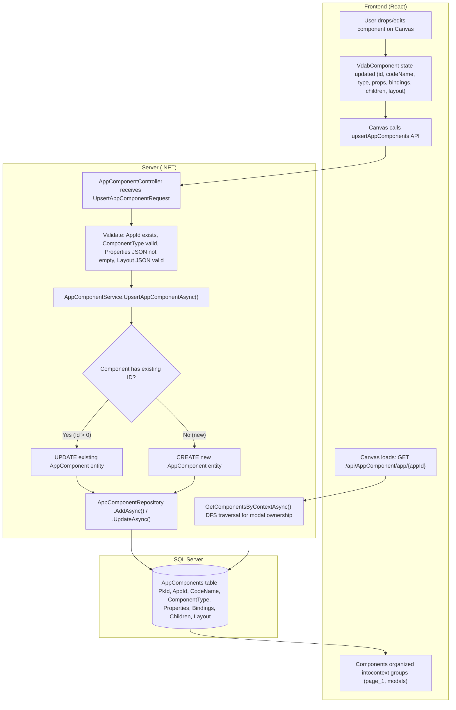
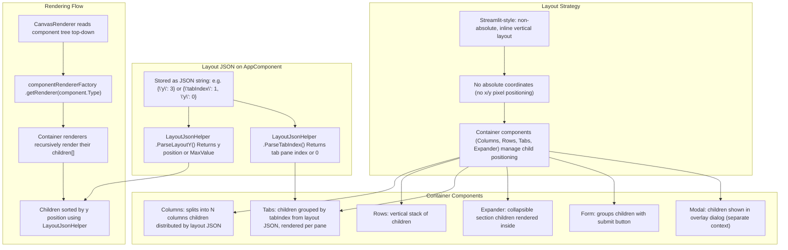
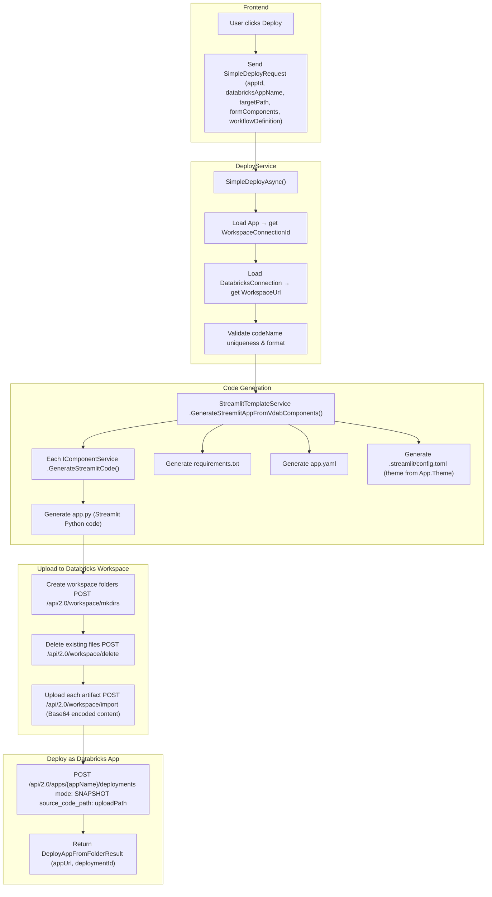
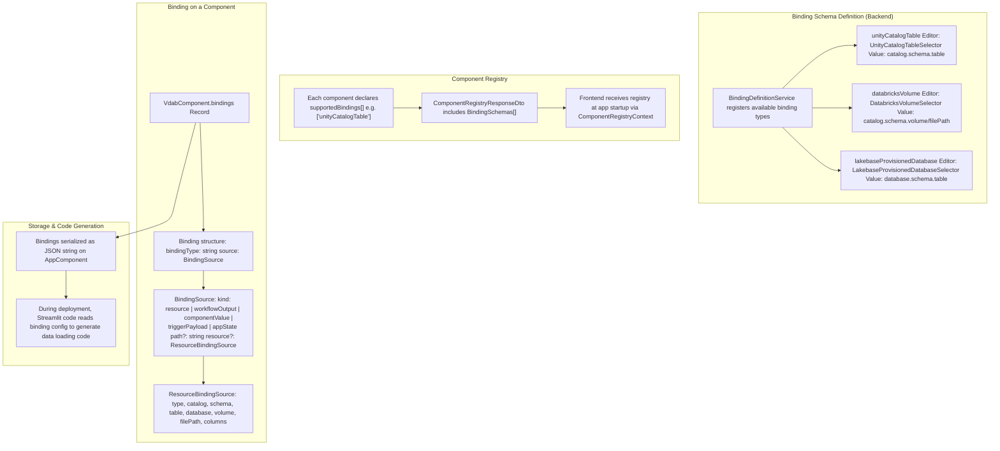
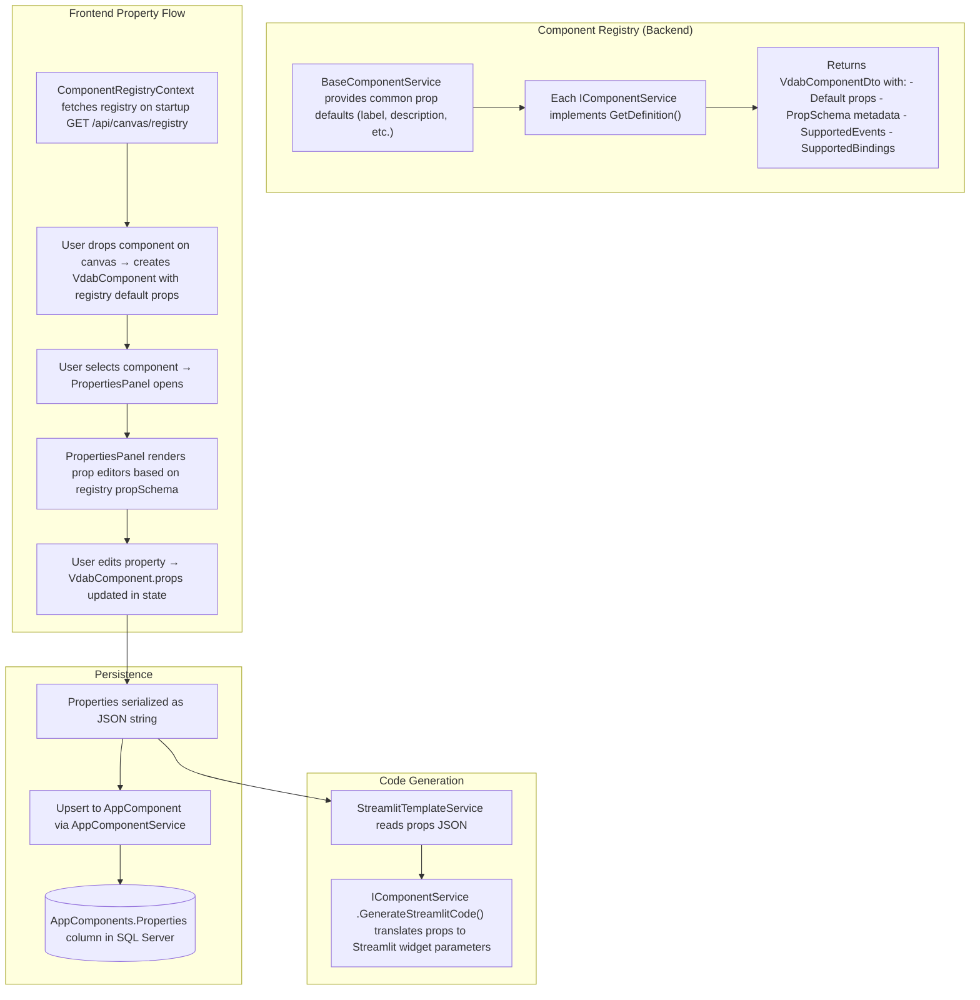
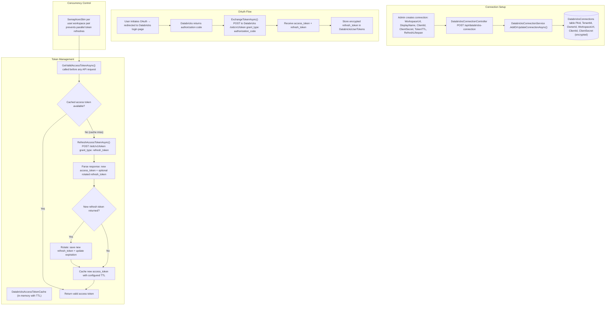

# VDAB Process Diagrams

> **Legacy SaaS architecture diagrams:** These diagrams document the former application flows and are not the standalone Node/Databricks architecture. See the [active Node architecture](standards/node-databricks-app-architecture.md) and [transition plan](databricks-app-transition/README.md).

Six architectural process diagrams showing how key systems work in the Visual Databricks App Builder.

---

## 1. Storing App Components

How components are saved from the builder canvas to the database and loaded back.

> [!NOTE]
> **Batch upsert**: The canvas typically uses `UpsertAppComponentsBatchAsync()` in `Xorbix-Visual-Databricks-App-Builder.Services/AppComponentService.cs`, which iterates over each component calling the single upsert. Failed items are logged but don't block the batch.

---

## 2. Layout System

How components are positioned on the canvas using a Streamlit-style vertical layout strategy.

---

## 3. Deployment

End-to-end flow from builder canvas to a running Databricks App (Streamlit).

> [!IMPORTANT]
> **Code preview** is also available via `PreviewGeneratedCodeAsync()` in `Xorbix-Visual-Databricks-App-Builder.Services/DeployService.cs` — same code generation pipeline but without the upload/deploy steps. Users can inspect `app.py`, `requirements.txt`, etc. before deploying.

---

## 4. Bindings

How components connect to Databricks data sources through the binding system.

---

## 5. Properties

How component properties are defined, edited, and persisted throughout the system.

> [!TIP]
> **Props are dynamic** — `Record<string, any>` validated by the registry schema at the frontend. Backend validates non-empty JSON but doesn't enforce individual property schemas beyond specific component-level validation (e.g., Tabs requires `≥1` tab, names `≤100` chars).

---

## 6. Databricks Connections

How users authenticate and maintain connections to Databricks workspaces.

> [!IMPORTANT]
> **Token lifecycle**: Access tokens are short-lived (configurable TTL via `AccessTokenTtlMinutes`). Refresh tokens can live up to 90 days (`RefreshTokenLifespanMinutes`). If a refresh token expires, the user must re-authenticate via OAuth.
